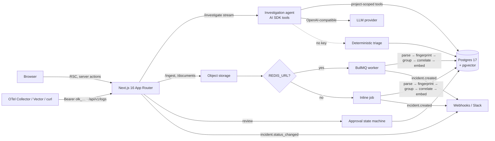

# OpsLens AI

**Production incident investigation with evidence, not guesses.**

Ask *"Why did our payment service start returning 500 errors after the last deployment?"* and OpsLens pulls the logs, the deployments around the first error, your runbooks and similar past incidents, then returns ranked hypotheses with **verified citations**, **calibrated confidence**, and a remediation plan that **waits for human approval**.

OpsLens is a multi-tenant SaaS built around existing LLMs. The engineering work is in what surrounds the model: data modelling, retrieval, grounding guardrails, tenancy, approval workflows and the operational architecture.

[](https://github.com/bileldh-ing/-opslens-ai-/actions/workflows/ci.yml)
[](https://github.com/bileldh-ing/-opslens-ai-/actions/workflows/docker.yml)
[](https://github.com/bileldh-ing/-opslens-ai-/actions/workflows/codeql.yml)
[](https://github.com/bileldh-ing/-opslens-ai-/actions/workflows/lighthouse.yml)


---

## Try it in one minute (no Docker, no API key)

```bash
git clone https://github.com/bileldh-ing/-opslens-ai- && cd -- -opslens-ai-
npm install
cp .env.example .env
npm run setup        # migrates an embedded Postgres + pgvector and seeds the demo
npm run dev
```

Open http://localhost:3000, sign in as **demo@opslens.dev / opslens-demo-123**, open **Incidents**, then **Investigate with AI**.

Without a model key, OpsLens runs in **demo mode**: investigations are handled by a deterministic triage analyst and retrieval uses local hashing embeddings, so the full product works offline. Add `OPENAI_API_KEY` (or any OpenAI-compatible `AI_BASE_URL`, such as Ollama) to switch on the LLM agent.

## What it does

| Area | Highlights |
|---|---|
| **SaaS workspace** | Organizations, projects, teams, invitations with expiring single-use tokens, roles (owner/admin/member/viewer), plan limits enforced server-side, full audit log, session auth with hashed opaque tokens |
| **Incident intelligence** | Log ingestion (JSON lines, pino numeric levels, plain text) → normalisation → **error fingerprinting** → recurring error groups → automatic incidents with **severity inference** and **deployment correlation** → incident timeline and status workflow |
| **AI investigation agent** | AI SDK 7 tool-calling agent: full-text log search, error groups, deployments, **pgvector RAG** over runbooks/postmortems/code and similar past incidents. Tool calls stream to the UI as they happen; every step is persisted |
| **Grounding guardrail** | Every citation must reference an id a tool actually returned in this run. Unverifiable citations are dropped, confidence is discounted, and a conclusion left without evidence is downgraded to *inconclusive*. The model is told it may answer *insufficient data* |
| **Safe remediation** | Rollbacks, runbooks, read-only diagnostic queries and draft patches are stored as `pending_approval`. Explicit state machine, admin-only approval, a second reviewer for high-risk changes, every decision audited. Nothing executes automatically |
| **Evaluation** | Golden cases graded on grounding (status, top cause, required citation types, and *not* being confident when there is no data), run from CI, the CLI or the **Quality** page, with history |
| **Ingestion API** | Project-scoped ingest keys (hashed, revocable) and `POST /api/v1/logs` accepting NDJSON, JSON arrays and **OTLP logs JSON**, so an OpenTelemetry Collector, Vector or curl can ship logs directly ([docs](docs/ingest-api.md)) |
| **Notifications** | Webhooks on new incidents and status changes: HMAC-signed JSON or Slack-compatible payloads, test button, delivery log, SSRF guard ([docs](docs/webhooks.md)) |
| **Exports** | Incident report as JSON (full record) or CSV (timeline) for post-mortems and tickets |
| **Production-ready** | zod-validated config, CSP + security headers, request ids + JSON logs, brute-force protection, `/api/health` + `/api/ready`, styled error boundaries, installable PWA with offline fallback |

## Architecture



**One codebase, two runtimes.** `DATABASE_URL=postgres://…` uses node-postgres; `pglite://…` runs the same migrations on embedded Postgres 17 with pgvector compiled to WASM. Redis is likewise optional: with it, uploads go through BullMQ with retries and backoff; without it, jobs run inline and rate limits are in-process.

**Tenancy.** Every query is scoped by organization. Agent tools are constructed per project, so the model has no way to reach another tenant's rows, whatever it asks for. Non-members get a 404 rather than a 403.

**Data model** (`src/db/schema.ts`, migrations in `drizzle/`): users, sessions, organizations, memberships, teams, invitations, projects, audit_logs, services, deployments, log_events (GIN full-text index), error_groups (unique fingerprint per project), incidents (HNSW index on summary embeddings), incident_events, documents, document_chunks (HNSW cosine), investigations, investigation_steps, remediations.

## Design decisions

- **Citations are verified, not trusted.** The LLM is good at sounding sure. The guardrail in `src/server/ai/report.ts` turns *"cites a log line"* into a checkable property.
- **A rule-based analyst as baseline.** `src/server/ai/triage.ts` uses the same tools and output schema as the agent. It keeps the product usable offline and gives the eval harness something to beat.
- **Proposals, never actions.** Remediations are data with a lifecycle (`draft → pending_approval → approved/rejected → executed`) so that the AI cannot change production by itself.
- **Fingerprints over clustering.** Normalising ids, numbers, hashes and durations before hashing gives stable, explainable error groups without a model in the ingest path.

## Project structure

```
src/
  app/                 routes: landing, auth, /[org]/{overview,incidents,investigate,remediations,sources,audit,settings}
  app/api/             ingest, documents, investigate (streaming), remediation review,
                       v1/logs (API-key ingest), incidents/[id]/export, health, ready
  server/ingest/       parse, fingerprint, correlate, chunk, pipeline
  server/ai/           agent, tools, triage, report (guardrail), embeddings, prompts, models
  server/jobs/         BullMQ queue, worker, shared handlers
  server/integrations/ ingest API keys, webhooks (signing, SSRF guard, delivery log)
  server/evals/        golden cases, grader, recorded runs
  lib/                 auth, rbac, plans, audit, rate-limit, login-guard, env, logger, security-headers, storage
  db/                  schema, client (pg or PGlite), migrator
drizzle/               SQL migrations
tests/                 unit tests + integration tests on embedded Postgres
e2e/                   Playwright specs (seeded PGlite server)
docs/                  ingest API and webhook references
evals/                 golden investigation cases and runner
data/sample/           payment-service 500s scenario: logs, deployments, runbook, postmortem
```

## Testing

```bash
npm run lint
npm run typecheck
npm test              # unit + integration on embedded Postgres + pgvector (serial)
npm run test:coverage
npm run eval          # golden investigation cases (LLM agent if a key is set, triage otherwise)
npm run e2e:install && npm run e2e   # Playwright against a freshly seeded server
```

| Suite | What it covers |
|---|---|
| Unit | parsing, fingerprints, correlation, RBAC, citation guardrail, triage, env validation, logger, login guard, security headers, OTLP mapping, webhook signing + SSRF guard, CSV export, eval grading |
| Integration (PGlite) | migrations, seed, ingestion → incidents, retrieval, triage, tenant isolation, API-key ingest route (NDJSON + OTLP + revocation), signed webhook delivery + delivery log, incident export, readiness, recorded eval runs |
| E2E (Playwright) | headers + probes, PWA manifest/icons/offline, login, dashboard, incident detail + export + triage investigation, log upload, ingest key lifecycle, webhook test delivery, Quality page, audit log |

## CI/CD

| Workflow | Runs |
|---|---|
| [`ci.yml`](.github/workflows/ci.yml) | `npm ci` (cached) → lint → typecheck → tests with coverage → offline evals → `next build` → Playwright E2E against the built app (HTML report + videos uploaded) · migrations, seed, evals and readiness against `pgvector/pgvector:pg17` + Redis service containers |
| [`docker.yml`](.github/workflows/docker.yml) | multi-stage build, container smoke test on `/api/health`, Trivy scan (SARIF to code scanning, fails on fixable CRITICAL), multi-arch push to `ghcr.io/bileldh-ing/opslens-ai` on `main` and tags with SBOM + provenance attestation |
| [`codeql.yml`](.github/workflows/codeql.yml) | CodeQL security-and-quality on pushes, PRs and weekly |
| [`lighthouse.yml`](.github/workflows/lighthouse.yml) | Lighthouse CI on `/`, `/login`, `/offline` with budgets in [`lighthouserc.json`](lighthouserc.json) (accessibility ≥ 0.9 and CLS ≤ 0.1 are hard gates) |
| [`release.yml`](.github/workflows/release.yml) | on `v*` tags: verify, build, generate release notes from commits, publish a GitHub Release with the standalone bundle + checksum |
| [`dependabot.yml`](.github/dependabot.yml) | weekly grouped npm, Actions and Docker updates |

Cut a release with `git tag v1.0.0 && git push origin v1.0.0`.

## Deployment

### Container image

```bash
docker pull ghcr.io/bileldh-ing/opslens-ai:latest
docker run -p 3000:3000 \
  -e DATABASE_URL=postgres://user:pass@db:5432/opslens \
  -e APP_URL=https://opslens.example.com \
  -e REDIS_URL=redis://redis:6379 \
  ghcr.io/bileldh-ing/opslens-ai:latest
```

The image runs the Next.js standalone server as a non-root user with a `HEALTHCHECK` on
`/api/health`. Run migrations once per release with the `worker` target
(`docker compose run --rm migrate`, or `npm run db:migrate` from a checkout).

| Variable | Required | Notes |
|---|---|---|
| `DATABASE_URL` | yes (prod) | `postgres://…` (pgvector extension required) or `pglite://<dir>` for single-node demos |
| `APP_URL` | yes (prod) | public URL; used in webhook deep links and enables HSTS when `https://` |
| `REDIS_URL` | recommended | BullMQ worker + rate limits shared across instances |
| `OPENAI_API_KEY` / `AI_BASE_URL` | optional | enables the LLM agent (any OpenAI-compatible endpoint) |
| `AI_CHAT_MODEL`, `AI_EMBEDDING_MODEL` | optional | defaults `gpt-4.1-mini`, `text-embedding-3-small` |
| `LOG_LEVEL` | optional | `debug`·`info`·`warn`·`error`·`silent` |
| `UPLOAD_DIR` | optional | where uploaded originals are stored |

Invalid configuration stops the server at boot with a list of every problem.

Probes: liveness `GET /api/health` (never touches dependencies), readiness `GET /api/ready`
(database, plus Redis when configured; `503` when unavailable). Logs are JSON lines carrying the
`X-Request-Id` that is also returned to clients.

### Docker Compose (full stack)

```bash
docker compose up --build          # postgres + redis + migrate job + app + worker
docker compose run --rm seed       # optional demo workspace
```

## Install as an app (PWA)

OpsLens ships a web app manifest, maskable icons and a service worker, so it installs like a
native app: in Chrome or Edge use **Install OpsLens** in the address bar; on iOS Safari use
**Share → Add to Home Screen**; on Android, **Add to Home screen**. The service worker only caches
static assets and an offline page; incident data and API calls always go to the network.

## Demo mode (for recordings)

```bash
npm run demo            # seeds .data/demo, records a baseline eval run, serves :3000
npm run demo -- --reset # start from a clean demo database
npm run webhook:receiver  # optional: local webhook endpoint on :4000 that verifies signatures
```

### Recording the product tour

`e2e/demo.tour.ts` is a scripted walkthrough of every feature (visible cursor, click ripples, smooth scrolling,
deliberate pauses) that writes per-scene timestamps to `demo-output/scenes.json`. It is not part of the E2E suite.
The manual **Demo video** workflow (`.github/workflows/demo-video.yml`, *Actions → Demo video → Run workflow*) builds the app,
starts the demo server and webhook receiver, runs the tour in headed Chromium on a virtual display, captures it with ffmpeg,
and uploads the raw recording plus `scenes.json` as the `demo-tour` artifact. To run it locally against `npm run demo`:

```bash
npx playwright test -c playwright.demo.config.ts   # needs a display (e.g. xvfb-run) because it runs headed
```

## Roadmap

- [ ] GitHub integration: read the diff of the suspected deploy, open draft PRs for approved patches
- [x] OpenTelemetry (OTLP/JSON) ingestion endpoint
- [ ] Live tail and OTLP protobuf
- [ ] Stripe billing for plan upgrades
- [x] Eval dashboard with run history
- [ ] Per-model comparisons and webhook retries with backoff
- [x] Slack-compatible notifications for new incidents and status changes
- [ ] Notifications for approval requests

## License

MIT © Bilel Dhahri
